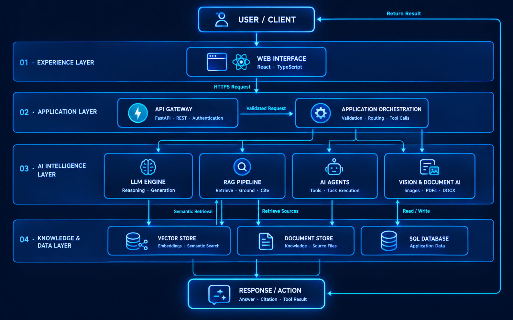

<!-- ========================================================= -->
<!-- HERO                                                      -->
<!-- ========================================================= -->

&nbsp;

&nbsp;

<!-- ========================================================= -->
<!-- INTRO                                                     -->
<!-- ========================================================= -->

    <picture> <source media="(prefers-color-scheme: dark)" srcset="./Assets/hologram-dark.svg"> <source media="(prefers-color-scheme: light)" srcset="./Assets/hologram-dark.svg">  </picture>   <h3>🤖 AI Application Engineer • 💻 Software Developer • 🌐 Application Builder</h3> 
<b>I build intelligent applications that turn ideas, models, APIs, and automation into usable software.</b>
 <blockquote><b>From idea → architecture → code → AI → API → interface → deployment.</b></blockquote> 

<!-- ========================================================= -->
<!-- APPLICATION ENGINEERING                                   -->
<!-- ========================================================= -->

<h3>Building Intelligent Applications. Engineering Complete Systems.</h3>

<i>From AI-powered experiences to scalable, full-stack software — turning ideas into working applications.</i>

<table width="100%">
<tr>
<td width="50%" valign="top" align="center">

<h3>🤖 AI APPLICATIONS</h3>

Building useful applications powered by modern AI.

</td>
<td width="50%" valign="top" align="center">

<h3>🌐 APPLICATION DEVELOPMENT</h3>

Creating responsive interfaces and connected applications.

</td>
</tr>
<tr>
<td width="50%" valign="top" align="center">

<h3>🧠 INTELLIGENT SYSTEMS</h3>

Transforming data and workflows into smarter experiences.

</td>
<td width="50%" valign="top" align="center">

<h3>⚙️ ENGINEERING &amp; INFRASTRUCTURE</h3>

Building maintainable, secure, and reliable software systems.

</td>
</tr>
</table>

<b>MY APPROACH</b>

<code>Understand → Design → Build → Test → Ship</code>

Engineering complete applications, not just isolated features.

<h3>💡 Engineering Philosophy</h3>

<blockquote>
<b>Don't just build models. Build applications around them.</b> 
<b>Don't just write code. Build systems that solve problems.</b>
</blockquote>

<!-- ========================================================= -->
<!-- WHAT I BUILD                                              -->
<!-- ========================================================= -->

 

<table width="100%">
<tr>
<th align="center" width="33%">🤖 AI APPLICATIONS</th>
<th align="center" width="33%">🌐 APPLICATIONS</th>
<th align="center" width="33%">⚙️ ENGINEERING</th>
</tr>
<tr>
<td align="center"></td>
<td align="center"></td>
<td align="center"></td>
</tr>
<tr>
<td align="center"></td>
<td align="center"></td>
<td align="center"></td>
</tr>
<tr>
<td align="center"></td>
<td align="center"></td>
<td align="center"></td>
</tr>
<tr>
<td align="center"></td>
<td align="center"></td>
<td align="center"></td>
</tr>
<tr>
<td align="center"></td>
<td align="center"></td>
<td align="center"></td>
</tr>
<tr>
<td align="center"></td>
<td align="center"></td>
<td align="center"></td>
</tr>
</table>

<!-- ========================================================= -->
<!-- AI APPLICATION ENGINEERING                                -->
<!-- ========================================================= -->

<h3>🧠 AI Systems I Work With</h3>

INTELLIGENCE &nbsp;•&nbsp; RETRIEVAL &nbsp;•&nbsp; AUTOMATION &nbsp;•&nbsp; ENGINEERING

 

<table width="100%">
<thead>
<tr>
<th align="center" width="30%">AI DOMAIN</th>
<th align="left" width="70%">ENGINEERING FOCUS</th>
</tr>
</thead>
<tbody>

<tr>
<td align="center" valign="middle"></td>
<td valign="middle">
AI-powered features, intelligent assistants, structured generation and smart workflows.  

</td>
</tr>

<tr>
<td align="center" valign="middle"></td>
<td valign="middle">
Grounded question answering, document retrieval, semantic search and source citations.  

</td>
</tr>

<tr>
<td align="center" valign="middle"></td>
<td valign="middle">
Tool-enabled assistants, multi-step workflows and task execution.  

</td>
</tr>

<tr>
<td align="center" valign="middle"></td>
<td valign="middle">
Image analysis, face recognition and intelligent visual detection.  

</td>
</tr>

<tr>
<td align="center" valign="middle"></td>
<td valign="middle">
PDF and DOCX processing, information extraction, document knowledge and Q&amp;A.  

</td>
</tr>

<tr>
<td align="center" valign="middle"></td>
<td valign="middle">
Speech interfaces, transcription workflows and conversational experiences.  

</td>
</tr>

<tr>
<td align="center" valign="middle"></td>
<td valign="middle">
Intelligent productivity tools, repeatable workflows and automated task execution.  

</td>
</tr>

<tr>
<td align="center" valign="middle"></td>
<td valign="middle">
Locally hosted language models, privacy-conscious processing and offline inference.  

</td>
</tr>

</tbody>
</table>

 

<!-- ========================================================= -->
<!-- AI APPLICATION ARCHITECTURE                               -->
<!-- ========================================================= -->

A LAYERED VIEW OF HOW AN AI APPLICATION CONNECTS ITS INTERFACE, BACKEND, INTELLIGENCE AND DATA

  

<h3>⚡ ENGINEERING WORKFLOW</h3>

INTELLIGENT APPLICATIONS · CONNECTED SYSTEMS · PRODUCTION-MINDED ENGINEERING

<!-- ========================================================= -->
<!-- ENGINEERING STACK                                         -->
<!-- ========================================================= -->

 

<table>
<tr>
<td align="center" valign="middle" width="50%">

<h3>🐍 Languages</h3>

</td>
<td align="center" valign="middle" width="50%">

<h3>🤖 AI / Machine Learning</h3>

 
<b>LLMs • RAG • Embeddings • Vector Search • AI Agents • Computer Vision • Prompt Engineering • Local AI</b>

</td>
</tr>
<tr>
<td align="center" valign="middle">

<h3>🌐 Application Development</h3>

</td>
<td align="center" valign="middle">

<h3>🗄️ Data &amp; Infrastructure</h3>

</td>
</tr>
<tr>
<td align="center" valign="middle" colspan="2">

<h3>🔧 Developer Tools</h3>

</td>
</tr>
</table>

<!-- ========================================================= -->
<!-- MY AI PROJECTS                                            -->
<!-- ========================================================= -->

<table width="100%">
<tr>
<td width="50%" valign="top" align="center">

<h3>📚 <a href="https://github.com/MUdevelops/Documind_AI">DocuMind AI</a></h3>

<b>Your documents. Your infrastructure. Your AI.</b>

A privacy-focused document intelligence platform that uses local RAG to search documents, retrieve relevant information, and answer questions with contextual source citations.

<a href="https://github.com/MUdevelops/Documind_AI"><strong>Explore Repository →</strong></a>

</td>
<td width="50%" valign="top" align="center">

<h3>🎯 <a href="https://github.com/MUdevelops/IntervuAI">IntervuAI</a></h3>

<b>Practice smarter. Interview better.</b>

An AI-powered interview coach offering role-based interview practice through voice and typing, with performance feedback to help users improve their answers and interview readiness.

<a href="https://github.com/MUdevelops/IntervuAI"><strong>Explore Repository →</strong></a>

</td>
</tr>

<tr>
<td width="50%" valign="top" align="center">

<h3>🕸️ <a href="https://github.com/MUdevelops/Gitma-AI">Gitma AI</a></h3>

<b>An AI assistant that knows my developer identity.</b>

A personalized browser-based AI assistant built around the MUdevelops ecosystem, combining project-aware conversations, general AI chat, streaming responses, and code generation.

<a href="https://github.com/MUdevelops/Gitma-AI"><strong>Explore Repository →</strong></a>

</td>
<td width="50%" valign="top" align="center">

<h3>🔴 <a href="https://github.com/MUdevelops/Redora_AI">Redora AI</a></h3>

<b>Customer support that actually understands.</b>

An AI customer-support chatbot designed to handle common questions with instant local responses and switch to AI-powered answers when additional intelligence is needed.

<a href="https://github.com/MUdevelops/Redora_AI"><strong>Explore Repository →</strong></a>

</td>
</tr>

<tr>
<td width="50%" valign="top" align="center">

<h3>🎙️ <a href="https://github.com/MUdevelops/Marcus-PC-Assistant">Marcus PC Assistant</a></h3>

<b>Your PC. Your voice. Your assistant.</b>

A futuristic, Jarvis-inspired Windows voice assistant that lets users interact with their PC through natural voice commands and practical desktop automation.

<a href="https://github.com/MUdevelops/Marcus-PC-Assistant"><strong>Explore Repository →</strong></a>

</td>
<td width="50%" valign="top" align="center">

<h3>🎨 <a href="https://github.com/MUdevelops/FinDraw-AI">FinDraw-AI</a></h3>

<b>Draw. Detect. Understand.</b>

An intelligent drawing application that recognizes hand-drawn geometric shapes and transforms rough sketches into cleaner, structured visual elements.

<a href="https://github.com/MUdevelops/FinDraw-AI"><strong>Explore Repository →</strong></a>

</td>
</tr>

<tr>
<td width="50%" valign="top" align="center">

<h3>🧪 <a href="https://github.com/MUdevelops/Machine-Learning-Forge">Machine Learning Forge</a></h3>

<b>Experiment. Evaluate. Learn.</b>

A hands-on machine learning laboratory exploring ten predictive models with practical experiments, model evaluation, and visual analysis using real datasets.

<a href="https://github.com/MUdevelops/Machine-Learning-Forge"><strong>Explore Repository →</strong></a>

</td>
<td width="50%" valign="top" align="center">

<h3>🎵 <a href="https://github.com/MUdevelops/EBMP-Emotion-Based-Music-Player">Emotion-Based Music Player</a></h3>

<b>Music that matches your mood.</b>

A Python desktop application that detects mood through facial expressions, voice, or manual selection and plays matching music, with YouTube integration.

<a href="https://github.com/MUdevelops/EBMP-Emotion-Based-Music-Player"><strong>Explore Repository →</strong></a>

</td>
</tr>
</table>

&nbsp;

AI APPLICATION ENGINEERING · INTELLIGENT SYSTEMS · BUILD · SHIP · IMPROVE

<!-- ========================================================= -->
<!-- CURRENTLY EXPLORING                                       -->
<!-- ========================================================= -->

 

<!-- ========================================================= -->
<!-- ENGINEERING PRINCIPLES                                    -->
<!-- ========================================================= -->

<h3><code>"Don't just consume technology. Build with it."</code></h3>

<!-- ========================================================= -->
<!-- CONTRIBUTION ACTIVITY                                     -->
<!-- ========================================================= -->

 

  

<!-- ========================================================= -->
<!-- OPEN TO OPPORTUNITIES                                     -->
<!-- ========================================================= -->

 

<table width="100%">
<tr>
<td align="center" valign="middle" width="33%">
<h1>🤖</h1>

</td>
<td align="center" valign="middle" width="33%">
<h1>💻</h1>

</td>
<td align="center" valign="middle" width="33%">
<h1>🌐</h1>

</td>
</tr>
<tr>
<td align="center" valign="middle" width="33%">
<h1>🧠</h1>

</td>
<td align="center" valign="middle" width="33%">
<h1>⚙️</h1>

</td>
<td align="center" valign="middle" width="33%">
<h1>🚀</h1>

</td>
</tr>
</table>

<!-- ========================================================= -->
<!-- CONNECT                                                   -->
<!-- ========================================================= -->

 

<b>Let's Connect, Collaborate &amp; Build Something Great!</b>

&nbsp;

&nbsp;

<!-- ========================================================= -->
<!-- FOOTER                                                    -->
<!-- ========================================================= -->

  

