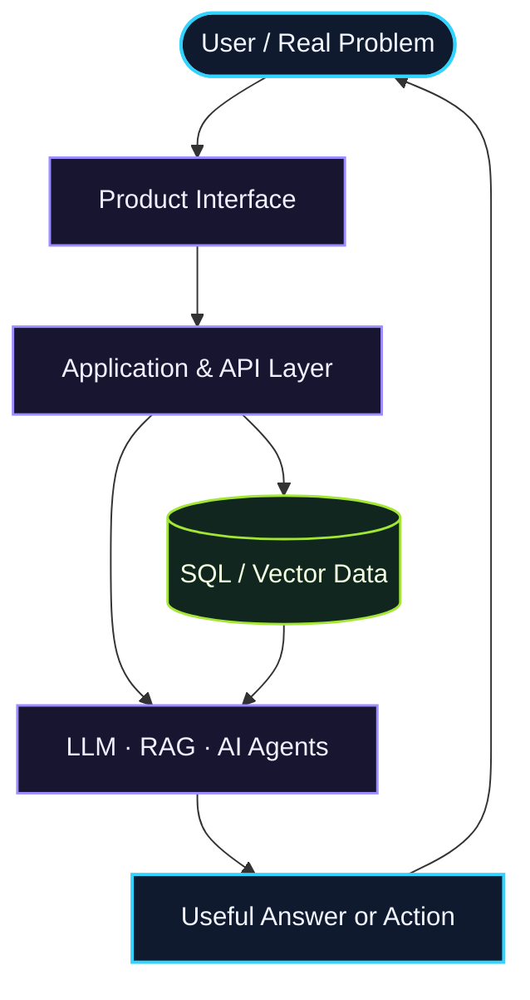

 

&nbsp;

&nbsp;

  

---

## 01 / The mission

### I build the software layer that makes AI useful.

I’m **Muhammad Umar Jamal**, an AI Application Engineer focused on turning models, APIs, automation, and product ideas into usable applications. I care about the full system—not just the model or the interface, but how the pieces work together.

> **Ideas → Architecture → Application → Intelligence → Real-world utility.**

<table>
  <tr>
    <td width="33%" valign="top">
      <h3>◈ AI APPLICATIONS</h3>
      LLM-powered features RAG & document intelligence AI assistants and agents Intelligent automation
    </td>
    <td width="33%" valign="top">
      <h3>⌘ PRODUCT ENGINEERING</h3>
      React interfaces Python & FastAPI services REST API integration Practical desktop and web apps
    </td>
    <td width="33%" valign="top">
      <h3>⟡ SYSTEMS</h3>
      Data and retrieval layers Authentication and persistence Testing and debugging Deployment-minded design
    </td>
  </tr>
</table>

---

## 02 / Selected builds

<table>
  <tr>
    <td width="50%" valign="top">
      <h3>📚 <a href="https://github.com/MUdevelops/Documind_AI">DocuMind AI</a></h3>
      <strong>Your documents. Your infrastructure. Your AI.</strong> 
      A local-first document intelligence platform built around retrieval-augmented generation, document Q&A, and contextual citations.
        
      PYTHON · FASTAPI · REACT · TYPESCRIPT · RAG
    </td>
    <td width="50%" valign="top">
      <h3>◇ <a href="https://github.com/MUdevelops/Gitma-AI">Gitma AI</a></h3>
      <strong>A more personal AI workspace for developers.</strong> 
      An AI assistant shaped around developer context, GitHub projects, and practical questions—not just generic chat.
        
      REACT · VITE · AI APPLICATIONS · DEVELOPER TOOLS
    </td>
  </tr>
  <tr>
    <td width="50%" valign="top">
      <h3>◉ <a href="https://github.com/CraftxCode/Redora_AI">Redora AI</a></h3>
      <strong>Customer support with a more human touch.</strong> 
      An AI customer-support agent project focused on clearer conversations and a polished support experience.
        
      AI AGENT · CUSTOMER SUPPORT · WEB APPLICATION
    </td>
    <td width="50%" valign="top">
      <h3>▣ <a href="https://github.com/MUdevelops/SlateFrame-OS">SlateFrame-OS</a></h3>
      <strong>A desktop environment built in Python.</strong> 
      A desktop-style system with productivity tools, settings, monitoring utilities, and a custom interface.
        
      PYTHON · DESKTOP SOFTWARE · UI ENGINEERING
    </td>
  </tr>
  <tr>
    <td width="50%" valign="top">
      <h3>⌁ <a href="https://github.com/MUdevelops/Marcus-PC-Assistant">Marcus PC Assistant</a></h3>
      <strong>Useful automation on the desktop.</strong> 
      A personal desktop assistant project combining natural interaction with practical system-level actions.
        
      PYTHON · AUTOMATION · DESKTOP
    </td>
    <td width="50%" valign="top">
      <h3>▤ <a href="https://github.com/MUdevelops/GPA-Calculator-Android">GPA Calculator Android</a></h3>
      <strong>Academic planning, made straightforward.</strong> 
      An Android GPA calculator for managing courses, subject components, and semester results.
        
      KOTLIN · ANDROID · XML
    </td>
  </tr>
</table>

  <a href="https://github.com/MUdevelops?tab=repositories"><strong>↗ Browse all repositories</strong></a>
  &nbsp; · &nbsp; More experiments include machine learning, computer vision, interview tools, and workforce management.

---

## 03 / How the pieces connect

The goal is simple: **make the whole application work well**, from the first interaction to the data and intelligence behind it.

---

## 04 / Engineering toolkit

  

| Focus | Current interests |
| :--- | :--- |
| **AI application engineering** | LLM applications, retrieval-augmented generation, tool calling, local AI |
| **Application development** | React, TypeScript, Python, FastAPI, Android, desktop utilities |
| **Data & infrastructure** | SQL databases, vector search, authentication, Docker, CI/CD fundamentals |
| **Core principles** | Maintainable code, meaningful tests, useful UX, responsible integration |

---

## 05 / Build philosophy

<table>
  <tr>
    <td width="50%" valign="top"><strong>01 — Solve a real problem</strong> Start with the user and the reason the software should exist.</td>
    <td width="50%" valign="top"><strong>02 — Engineer the whole system</strong> Connect the interface, logic, data, and AI instead of treating them as isolated pieces.</td>
  </tr>
  <tr>
    <td width="50%" valign="top"><strong>03 — Verify what you build</strong> Test behavior, handle failure cases, and improve what actually matters.</td>
    <td width="50%" valign="top"><strong>04 — Ship and iterate</strong> A useful working product beats an impressive unfinished prototype.</td>
  </tr>
</table>

### `BUILD  →  INTEGRATE  →  TEST  →  SHIP  →  IMPROVE`

---

## 06 / GitHub activity

  

---

## 07 / Let’s build something useful

I’m **open to freelance projects, collaboration, and full-time opportunities** where I can keep growing as an application engineer and help turn real problems into working software.

&nbsp;

  

