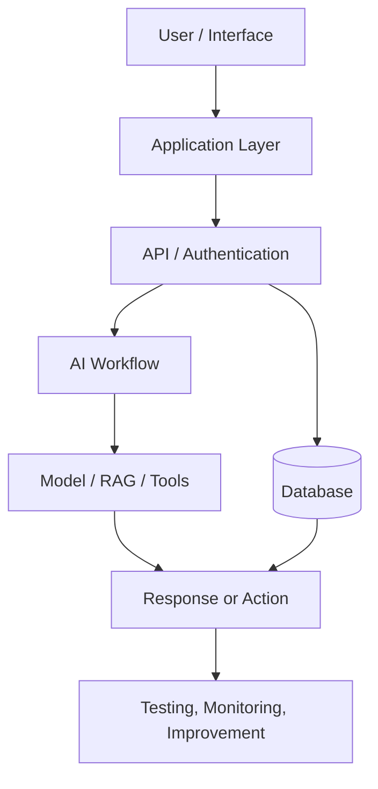

::: {align="center"}
``{=html}

``{=html}

`<br/>`{=html}

`<a href="https://m-umar-jamal.netlify.app/">`{=html}``{=html}`</a>`{=html}
`<a href="https://github.com/MUdevelops?tab=repositories">`{=html}``{=html}`</a>`{=html}
`<a href="https://github.com/MUdevelops">`{=html}``{=html}`</a>`{=html}

`<br/>`{=html}`<br/>`{=html}

``{=html}
:::

## 👋 Muhammad Umar Jamal

::: {align="center"}
### AI Application Engineer · Software Developer · Product Builder

**I turn ideas, models, APIs, and automation into useful, working
software.**

*From problem discovery → architecture → implementation → integration →
testing → deployment.*
:::

------------------------------------------------------------------------

## 🧭 About Me

::: {align="center"}
``{=html}
:::

I focus on **application engineering**: building complete software
experiences instead of isolated demos. My interests span AI-powered
products, full-stack applications, developer tools, and practical
automation.

-   🤖 **AI applications:** LLM workflows, RAG, agents, document
    intelligence, and computer vision
-   🌐 **Application development:** Python, React, TypeScript, APIs, and
    desktop tools
-   🧱 **Software engineering:** modular architecture, authentication,
    databases, testing, and deployment
-   🔒 **Practical systems:** privacy-aware, local-first, and
    maintainable solutions where they fit the problem

> **My philosophy:** Don't just connect a model. Engineer the
> application around it.

## ✨ What I Build

::: {align="center"}
``{=html}
:::

::: {align="center"}
  -----------------------------------------------------------------------------------------------------------------------------------------------------------------------------------------------------------------------------------------------------------------------------------------------------------------------------------------------------------
   ``{=html}   ``{=html}   ``{=html}
  -------------------------------------------------------------------------------------------------------------------------- --------------------------------------------------------------------------------------------------------------- ----------------------------------------------------------------------------------------------------------------
                                              LLM applications · RAG · AI agents                                                                                     Web apps · APIs · Desktop tools                                                                                Databases · Auth · Testing · CI/CD

                                               Document AI · Local AI · Vision                                                                                        React · TypeScript · FastAPI                                                                                 Docker · Git · Maintainable systems
  -----------------------------------------------------------------------------------------------------------------------------------------------------------------------------------------------------------------------------------------------------------------------------------------------------------------------------------------------------------
:::

## 🚀 Featured Projects

::: {align="center"}
``{=html}
:::

> A selection of products and experiments across AI, developer tooling,
> and application engineering. Project links below lead to the relevant
> repository when confirmed, or to the profile's repository list when a
> dedicated public URL is not confirmed.

```{=html}
<table>
```
```{=html}
<tr>
```
```{=html}
<td width="50%" valign="top">
```
### 💠 AIRegistry

**Reusable AI components, agents, and tools**

An open-source registry with a Python CLI and static website, designed
to help developers discover and install reusable AI building blocks.

`Python` `CLI` `JSON` `Cloudflare`

[↗ View repository](https://github.com/MUdevelops/AIRegistry)

```{=html}
</td>
```
```{=html}
<td width="50%" valign="top">
```
### 🎨 FinDraw-AI

**Draw. Detect. Understand.**

A Python desktop whiteboard that recognizes freehand geometric sketches
and helps turn them into structured visual elements.

`Python` `Tkinter` `Computer Vision`

[↗ View repository](https://github.com/MUdevelops/FinDraw-AI)

```{=html}
</td>
```
```{=html}
</tr>
```
```{=html}
<tr>
```
```{=html}
<td width="50%" valign="top">
```
### 🧠 DocuMind AI

**Your documents. Your infrastructure. Your AI.**

A local-first document intelligence concept focused on document
ingestion, retrieval, and contextual question answering.

`RAG` `Python` `FastAPI` `React`

[↗ Explore repositories](https://github.com/MUdevelops?tab=repositories)

```{=html}
</td>
```
```{=html}
<td width="50%" valign="top">
```
### 🎯 IntervuAI

**AI-powered interview intelligence**

An interview experience concept for guided practice, response analysis,
and actionable feedback.

`AI` `LLMs` `Web Applications`

[↗ Explore repositories](https://github.com/MUdevelops?tab=repositories)

```{=html}
</td>
```
```{=html}
</tr>
```
```{=html}
<tr>
```
```{=html}
<td width="50%" valign="top">
```
### 🛡️ TrueScanAI

**Offline-first attendance and workforce tools**

A desktop application direction focused on attendance workflows,
identity verification, and local data management.

`Python` `SQLite` `Computer Vision`

[↗ Explore repositories](https://github.com/MUdevelops?tab=repositories)

```{=html}
</td>
```
```{=html}
<td width="50%" valign="top">
```
### 💬 GITMA AI

**A personalized developer AI assistant**

A static chatbot concept for exploring developer projects and GitHub
context, designed around a lightweight frontend and a no-backend
approach.

`React` `Vite` `AI API`

[↗ Explore repositories](https://github.com/MUdevelops?tab=repositories)

```{=html}
</td>
```
```{=html}
</tr>
```
```{=html}
<tr>
```
```{=html}
<td width="50%" valign="top">
```
### 🖥️ Marcus PC Assistant

**An intelligent desktop assistant**

A desktop automation concept combining natural interaction with
practical system-level workflows.

`Python` `Automation` `Desktop`

[↗ Explore repositories](https://github.com/MUdevelops?tab=repositories)

```{=html}
</td>
```
```{=html}
<td width="50%" valign="top">
```
### 🤖 Redora AI

**A recognizable AI product identity**

An AI product and mascot direction focused on a consistent, polished
customer-support assistant experience.

`AI Product` `Brand Systems` `Assistant UX`

[↗ Explore repositories](https://github.com/MUdevelops?tab=repositories)

```{=html}
</td>
```
```{=html}
</tr>
```
```{=html}
</table>
```
::: {align="center"}
`<a href="https://github.com/MUdevelops?tab=repositories">`{=html}``{=html}`</a>`{=html}
:::

## 🧠 AI Application Engineering

::: {align="center"}
``{=html}
:::

  ---------------------------------------------------------------------
  Area                               What it means in practice
  ---------------------------------- ----------------------------------
  🧩 **LLM applications**            Useful AI features, assistants,
                                     and structured workflows

  📚 **RAG systems**                 Document retrieval, semantic
                                     search, and grounded responses

  🕸️ **AI agents** T                 ool use, task orchestration, and
                                     controlled automation

  👁️ **Computer vision** I           mage analysis, recognition, and
                                     verification workflows

  📄 **Document intelligence**       PDF/DOCX ingestion, extraction,
                                     and question answering

  🦙 **Local-first AI**              Privacy-conscious and
                                     offline-capable workflows where
                                     practical

  ⚡ **AI integration**              Connecting models to interfaces,
                                     APIs, data, and real user tasks
  ---------------------------------------------------------------------

### 🔄 A typical application architecture



## 🧰 Technology Stack

::: {align="center"}
``{=html}
:::

::: {align="center"}
**Languages**

``{=html}

**AI · Machine Learning · Data**

``{=html}

**Application Development**

``{=html}

**Infrastructure · Developer Tools**

``{=html}

``{=html}
:::

## ⚙️ How I Build

::: {align="center"}
``{=html}
:::

::: {align="center"}
``{=html}
``{=html}
``{=html}
``{=html}
``{=html}
:::

1.  **Understand the problem** --- define the user, constraints, and
    success criteria.
2.  **Design the system** --- choose a sensible architecture and data
    flow.
3.  **Build in coherent milestones** --- keep components understandable
    and maintainable.
4.  **Integrate and test** --- verify real workflows, not just isolated
    pieces.
5.  **Deploy and improve** --- document what works and iterate based on
    evidence.

## 🔭 Current Engineering Interests

::: {align="center"}
``{=html}
:::

::: {align="center"}
``{=html}
:::

-   Building reusable tools and components for AI application developers
-   Making AI features useful, testable, and integrated with real
    software
-   Exploring privacy-aware and local-first application design
-   Improving the path from prototype to maintainable software

## 📊 GitHub Activity

::: {align="center"}
``{=html}
:::

::: {align="center"}
``{=html}
``{=html}

`<br/>`{=html}

``{=html}

`<br/>`{=html}

``{=html}
:::

## 🎯 Engineering Principles

::: {align="center"}
``{=html}
:::

::: {align="center"}
  ---------------------------------------------------------------------
        🧩 Solve real problems           🏗️ Build complete systems
  ---------------------------------- ----------------------------------
     Technology serves people and    Features should work together as a
           useful outcomes.                  coherent product.

          🧪 Verify behavior                  🔐 Respect trust

  Test important workflows and edge     Treat data, credentials, and
                cases.                       privacy carefully.

      📦 Prefer maintainability              🚀 Finish and ship

    Clear structure beats needless    Deliver usable software, learn,
             complexity.                        and improve.
  ---------------------------------------------------------------------
:::

## 🤝 Open to Collaboration

::: {align="center"}
``{=html}
:::

I'm interested in collaborating on:

-   🤖 AI application engineering and LLM-powered products
-   🌐 Full-stack and API-driven software
-   🧰 Developer tools and reusable components
-   ⚙️ Automation and practical productivity software
-   🚀 Freelance projects with clear goals and real users

## 🌐 Connect

::: {align="center"}
``{=html}
:::

::: {align="center"}
`<a href="https://m-umar-jamal.netlify.app/">`{=html}``{=html}`</a>`{=html}
`<a href="https://github.com/MUdevelops">`{=html}``{=html}`</a>`{=html}
`<a href="https://github.com/MUdevelops?tab=repositories">`{=html}``{=html}`</a>`{=html}

`<br/>`{=html}`<br/>`{=html}

``{=html}

``{=html}
:::
