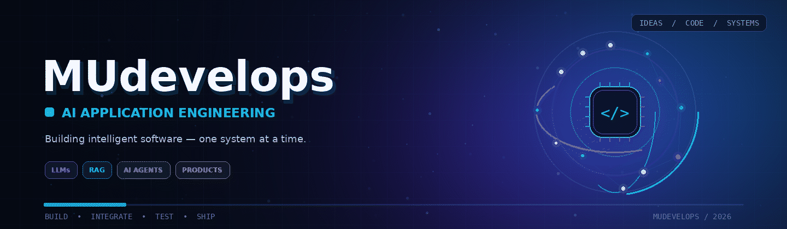
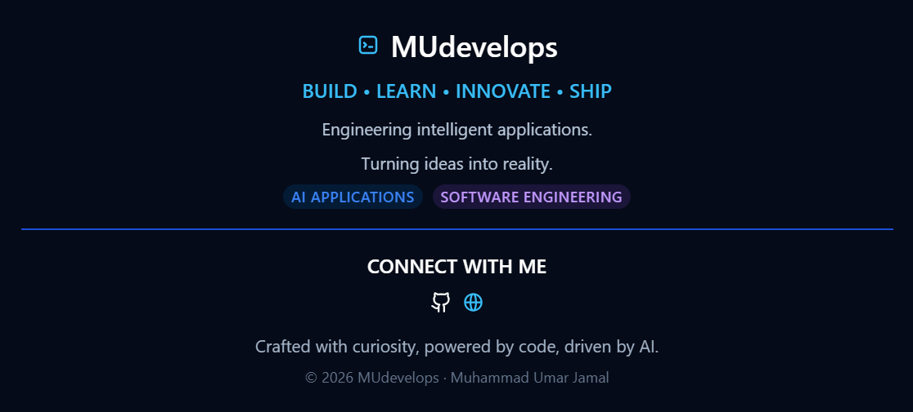

 

&nbsp;

&nbsp;

<!-- ========================================================= -->
<!-- INTRO -->
<!-- ========================================================= -->

  

 

### 🤖 AI Application Engineer • 💻 Software Developer • 🌐 Application Builder

**I build intelligent applications that turn ideas, models, APIs, and automation into usable software.**

 

> **From idea → architecture → code → AI → API → interface → deployment.**

---

<!-- ========================================================= -->
<!-- APPLICATION ENGINEERING -->
<!-- ========================================================= -->

 

### Building Intelligent Applications. Engineering Complete Systems.

*From AI-powered experiences to scalable, full-stack software — turning ideas into working applications.*

 

 

<table>
<tr>
<td width="50%" valign="top">

<h3 align="center">🤖 AI APPLICATIONS</h3>

Building useful applications powered by modern AI.

</td>
<td width="50%" valign="top">

<h3 align="center">🌐 APPLICATION DEVELOPMENT</h3>

Creating responsive interfaces and connected applications.

</td>
</tr>

<tr>
<td width="50%" valign="top">

<h3 align="center">🧠 INTELLIGENT SYSTEMS</h3>

Transforming data and workflows into smarter experiences.

</td>
<td width="50%" valign="top">

<h3 align="center">⚙️ ENGINEERING & INFRASTRUCTURE</h3>

Building maintainable, secure, and reliable software systems.

</td>
</tr>
</table>

 

**MY APPROACH**

`Understand → Design → Build → Test → Ship`

 

Engineering complete applications, not just isolated features.

### 💡 Engineering Philosophy

> **Don't just build models. Build applications around them.**
> **Don't just write code. Build systems that solve problems.**

---

<!-- ========================================================= -->
<!-- WHAT I BUILD -->
<!-- ========================================================= -->

  

<table>
<tr>
<th align="center">🤖 AI APPLICATIONS</th>
<th align="center">🌐 APPLICATIONS</th>
<th align="center">⚙️ ENGINEERING</th>
</tr>

<tr>
<td align="center">

</td>
<td align="center">

</td>
<td align="center">

</td>
</tr>

<tr>
<td align="center">

</td>
<td align="center">

</td>
<td align="center">

</td>
</tr>

<tr>
<td align="center">

</td>
<td align="center">

</td>
<td align="center">

</td>
</tr>

<tr>
<td align="center">

</td>
<td align="center">

</td>
<td align="center">

</td>
</tr>

<tr>
<td align="center">

</td>
<td align="center">

</td>
<td align="center">

</td>
</tr>

<tr>
<td align="center">

</td>
<td align="center">

</td>
<td align="center">

</td>
</tr>

</table>

 

 

---

<!-- ========================================================= -->
<!-- AI APPLICATION ENGINEERING -->
<!-- ========================================================= -->

 

  

### 🧠 AI Systems I Work With

INTELLIGENCE &nbsp; • &nbsp; RETRIEVAL &nbsp; • &nbsp; AUTOMATION &nbsp; • &nbsp; ENGINEERING

 

<!-- ========================================================= -->
<!-- COLORFUL AI CAPABILITY TABLE -->
<!-- ========================================================= -->

<table>
<thead>
<tr>
<th align="center">AI DOMAIN</th>
<th align="left">ENGINEERING FOCUS</th>
</tr>
</thead>
<tbody>

<tr>
<td align="center">

</td>
<td>
AI-powered features, intelligent assistants, structured generation and smart workflows.
  

</td>
</tr>

<tr>
<td align="center">

</td>
<td>
Grounded question answering, document retrieval, semantic search and source citations.
  

</td>
</tr>

<tr>
<td align="center">

</td>
<td>
Tool-enabled assistants, multi-step workflows and task execution.
  

</td>
</tr>

<tr>
<td align="center">

</td>
<td>
Image analysis, face recognition and intelligent visual detection.
  

</td>
</tr>

<tr>
<td align="center">

</td>
<td>
PDF and DOCX processing, information extraction, document knowledge and Q&A.
  

</td>
</tr>

<tr>
<td align="center">

</td>
<td>
Speech interfaces, transcription workflows and conversational experiences.
  

</td>
</tr>

<tr>
<td align="center">

</td>
<td>
Intelligent productivity tools, repeatable workflows and automated task execution.
  

</td>
</tr>

<tr>
<td align="center">

</td>
<td>
Locally hosted language models, privacy-conscious processing and offline inference.
  

</td>
</tr>

</tbody>
</table>

 

<!-- ========================================================= -->
<!-- FUTURISTIC AI APPLICATION ARCHITECTURE -->
<!-- ========================================================= -->

 

A LAYERED VIEW OF HOW AN AI APPLICATION CONNECTS ITS INTERFACE, BACKEND, INTELLIGENCE AND DATA

 

  

 

### ⚡ ENGINEERING WORKFLOW

  

INTELLIGENT APPLICATIONS · CONNECTED SYSTEMS · PRODUCTION-MINDED ENGINEERING

---
<!-- ========================================================= -->
<!-- TECH STACK -->
<!-- ========================================================= -->

  

### 🐍 Languages

  

### 🤖 AI / Machine Learning

 

**LLMs • RAG • Embeddings • Vector Search • AI Agents • Computer Vision • Prompt Engineering • Local AI**

  

### 🌐 Application Development

  

### 🗄️ Data & Infrastructure

  

### 🔧 Developer Tools

  

---

<!-- ========================================================= -->
<!-- FEATURED AI PROJECTS -->
<!-- ========================================================= -->

 

  

  

<table>
<tr>
<td width="50%" valign="top">

<h3>📚 <a href="https://github.com/MUdevelops/Documind_AI">DocuMind AI</a></h3>

**Your documents. Your infrastructure. Your AI.**

A privacy-focused document intelligence platform that uses local RAG to search documents, retrieve relevant information, and answer questions with contextual source citations.

 

<a href="https://github.com/MUdevelops/Documind_AI"><strong>Explore Repository →</strong></a>

</td>
<td width="50%" valign="top">

<h3>🎯 <a href="https://github.com/MUdevelops/IntervuAI">IntervuAI</a></h3>

**Practice smarter. Interview better.**

An AI-powered interview coach offering role-based interview practice through voice and typing, with performance feedback to help users improve their answers and interview readiness.

 

<a href="https://github.com/MUdevelops/IntervuAI"><strong>Explore Repository →</strong></a>

</td>
</tr>

<tr>
<td width="50%" valign="top">

<h3>🕸️ <a href="https://github.com/MUdevelops/Gitma-AI">Gitma AI</a></h3>

**An AI assistant that knows my developer identity.**

A personalized browser-based AI assistant built around the MUdevelops ecosystem, combining project-aware conversations, general AI chat, streaming responses, and code generation.

 

<a href="https://github.com/MUdevelops/Gitma-AI"><strong>Explore Repository →</strong></a>

</td>
<td width="50%" valign="top">

<h3>🔴 <a href="https://github.com/MUdevelops/Redora_AI">Redora AI</a></h3>

**Customer support that actually understands.**

An AI customer-support chatbot designed to handle common questions with instant local responses and switch to AI-powered answers when additional intelligence is needed.

 

<a href="https://github.com/MUdevelops/Redora_AI"><strong>Explore Repository →</strong></a>

</td>
</tr>

<tr>
<td width="50%" valign="top">

<h3>🎙️ <a href="https://github.com/MUdevelops/Marcus-PC-Assistant">Marcus PC Assistant</a></h3>

**Your PC. Your voice. Your assistant.**

A futuristic, Jarvis-inspired Windows voice assistant that lets users interact with their PC through natural voice commands and practical desktop automation.

 

<a href="https://github.com/MUdevelops/Marcus-PC-Assistant"><strong>Explore Repository →</strong></a>

</td>
<td width="50%" valign="top">

<h3>🎨 <a href="https://github.com/MUdevelops/FinDraw-AI">FinDraw-AI</a></h3>

**Draw. Detect. Understand.**

An intelligent drawing application that recognizes hand-drawn geometric shapes and transforms rough sketches into cleaner, structured visual elements.

 

<a href="https://github.com/MUdevelops/FinDraw-AI"><strong>Explore Repository →</strong></a>

</td>
</tr>

<tr>
<td width="50%" valign="top">

<h3>🧪 <a href="https://github.com/MUdevelops/Machine-Learning-Forge">Machine Learning Forge</a></h3>

**Experiment. Evaluate. Learn.**

A hands-on machine learning laboratory exploring ten predictive models with practical experiments, model evaluation, and visual analysis using real datasets.

 

<a href="https://github.com/MUdevelops/Machine-Learning-Forge"><strong>Explore Repository →</strong></a>

</td>
<td width="50%" valign="top">

<h3>🎵 <a href="https://github.com/MUdevelops/EBMP-Emotion-Based-Music-Player">Emotion-Based Music Player</a></h3>

**Music that matches your mood.**

A Python desktop application that detects mood through facial expressions, voice, or manual selection and plays matching music, with YouTube integration.

 

<a href="https://github.com/MUdevelops/EBMP-Emotion-Based-Music-Player"><strong>Explore Repository →</strong></a>

</td>
</tr>
</table>

 

  

  

AI APPLICATION ENGINEERING · INTELLIGENT SYSTEMS · BUILD · SHIP · IMPROVE

---

<!-- ========================================================= -->
<!-- CURRENTLY EXPLORING -->
<!-- ========================================================= -->

  

  

---

<!-- ========================================================= -->
<!-- ENGINEERING PRINCIPLES -->
<!-- ========================================================= -->

  

### `"Don't just consume technology. Build with it."`

 

---

<!-- ========================================================= -->
<!-- CONTRIBUTIONS -->
<!-- ========================================================= -->

  

  

---

<!-- ========================================================= -->
<!-- OPEN TO OPPORTUNITIES -->
<!-- ========================================================= -->

  

<table>
<tr>
<td align="center">🤖 <b>AI Application Engineering</b></td>
<td align="center">💻 <b>Software Engineering</b></td>
<td align="center">🌐 <b>Full-Stack Development</b></td>
</tr>
<tr>
<td align="center">🧠 <b>AI / ML Applications</b></td>
<td align="center">⚙️ <b>Automation</b></td>
<td align="center">🚀 <b>Freelance Projects</b></td>
</tr>
</table>

 

---

<!-- ========================================================= -->
<!-- CONNECT -->
<!-- ========================================================= -->

 

**Let's Connect, Collaborate & Build Something Great!**

 

&nbsp;

&nbsp;

---

<!-- ========================================================= -->
<!-- FOOTER -->
<!-- ========================================================= -->

